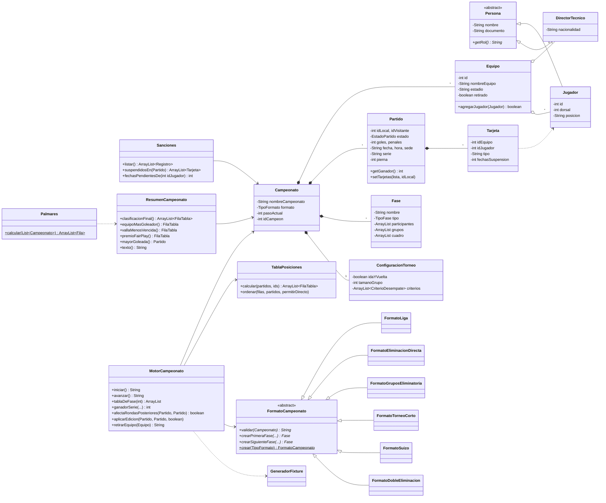
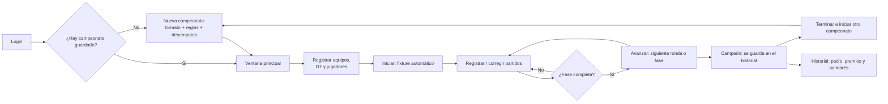

# Arquitectura de AlphaSport

El código Java está separado en cuatro paquetes. La versión web (`web/js/motor.js`) es una traducción directa de `modelo` + `logica`, con los mismos nombres de métodos.

```
vista  ──usa──▶  logica  ──usa──▶  modelo
  │                                   ▲
  └──────────usa──────▶ controlador ──┘   (guardar / leer)
```

| Paquete | Responsabilidad | No hace |
|---|---|---|
| `modelo` | Datos: equipos, jugadores, partidos, fases, configuración | No calcula tablas ni decide quién avanza |
| `logica` | Reglas del torneo: fixture, tablas, desempates, llaves, avanzar de fase, edición | No muestra ventanas |
| `logica.formatos` | Qué fases tiene cada formato y cómo se pasa de una a otra | — |
| `controlador` | Guardar y leer archivos (`campeonato.dat`, historial `.txt`) | — |
| `vista` | Ventanas y diálogos Swing. En la V2 todo el estilo está centralizado en `Estilo` (colores, fuentes, botones) | No contiene reglas del torneo |

## Diagrama de clases



## Conceptos de POO aplicados

| Concepto | Dónde |
|---|---|
| **Herencia** | `Jugador` y `DirectorTecnico` heredan de la clase abstracta `Persona`. Los 6 formatos heredan de `FormatoCampeonato`. |
| **Clases y métodos abstractos** | `Persona.getRol()`, `FormatoCampeonato.validar / crearPrimeraFase / crearSiguienteFase`. |
| **Polimorfismo** | `MotorCampeonato` llama `formato.crearSiguienteFase(...)` sin saber qué formato es; cada subclase responde a su manera. `FormatoCampeonato.crear(tipo)` es un método de fábrica. |
| **Encapsulamiento** | Atributos privados con getters/setters; las reglas viven en `logica` y la vista solo llama métodos públicos. |
| **Herencia en la vista (V2)** | `PanelCancha` extiende `JPanel` y sobrescribe `paintComponent` para dibujar la cancha; `IconoBalon` implementa la interfaz `Icon` para dibujar el balón con Java2D. |
| **Composición / agregación** | `Campeonato` contiene equipos, partidos, fases y configuración; `Equipo` agrega jugadores y un director técnico; `Partido` contiene sus `Tarjeta`. |
| **Enumeraciones** | `TipoFormato`, `TipoFase`, `EstadoPartido`, `CriterioDesempate` (con descripción). |
| **Excepciones** | `IllegalStateException` con mensajes para el usuario cuando no se puede iniciar o avanzar; la vista las muestra en un diálogo. |
| **Serialización** | Todo el modelo implementa `Serializable` para guardarse en `campeonato.dat`. |

En P2, `Partido` heredaba de `Campeonato` ("un partido es un campeonato"), lo que no tiene sentido como relación *es-un*. Ahora es una clase independiente y el campeonato **tiene** partidos (composición).

## Ideas clave del diseño

### 1. Las estadísticas se calculan, no se acumulan
En P2 cada equipo guardaba sus puntos y goles, y al registrar o corregir un resultado había que sumar y restar a mano (era fácil dejar la tabla mal). Ahora `Equipo` no guarda estadísticas: `TablaPosiciones.calcular` recorre los partidos jugados cada vez que se muestra una tabla. Corregir, borrar o aplazar un partido deja todo correcto automáticamente.

### 2. Fases y pasos
Un campeonato es una lista de **fases** (fase regular, grupos, liguilla, llave...). Cada vez que se genera algo (una fase o una ronda nueva) se incrementa el **paso** del campeonato y los partidos generados guardan ese número.

- El **formato** decide *qué* fases hay (`crearPrimeraFase`, `crearSiguienteFase`).
- El **motor** sabe *cómo* se juega cada tipo de fase (`TipoFase`): liga y grupos generan todo el calendario de una vez; suizo, eliminatoria y doble eliminación generan una ronda por paso.

### 3. Edición segura de partidos
Al editar un partido, `afectaRondasPosteriores` calcula una "huella" de lo que ese partido decide (el orden de su tabla o el ganador de su llave) antes y después del cambio. Si la huella cambia y hay pasos posteriores, la vista pregunta y `deshacerDesdePaso` borra solo lo que se generó después, para volver a generarlo con *Avanzar*.

### 4. Llaves sin estructuras extra
La llave guarda solo el orden de la primera ronda (`Fase.cuadro`, con posiciones `LIBRE` para los que pasan directo). Las rondas siguientes se deducen de los ganadores de cada serie (`ganadoresDeRonda`), así que editar un resultado se refleja solo.

### 5. Suspensiones calculadas
Igual que la tabla, las suspensiones no se guardan como contador: `Sanciones` las calcula recorriendo las rojas y los partidos siguientes de cada equipo. Si se corrige un resultado, se aplaza un partido o se borra una tarjeta, el estado de cada suspensión se actualiza solo. Las tarjetas guardan el id del jugador (no el dorsal), así que editar el dorsal no rompe nada.

### 6. Historial de campeonatos
Cada campeonato tiene un `codigo` único. Al terminar (o al reemplazarlo por otro con partidos jugados) el `Controlador` guarda una copia completa en `historial/campeonato_<codigo>.dat`; si se vuelve a guardar el mismo campeonato se reemplaza, nunca se duplica. Como se guarda el objeto completo y no un texto, el historial puede **recalcular** todo: `ResumenCampeonato` arma la clasificación final, el podio y los premios, y `Palmares` suma los resultados de todos los torneos por equipo. Al crear el siguiente torneo corto o un campeonato "con los mismos equipos" se copian los equipos con su plantilla, pero el campeonato nuevo recibe otro código.

## Flujo de uso


