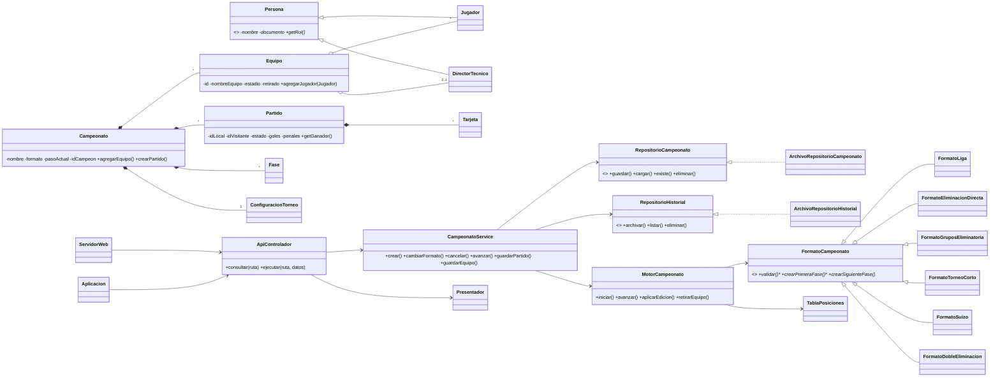
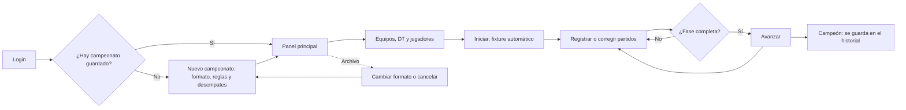

# Arquitectura de AlphaSport (V4)

AlphaSport está organizado en cuatro capas: **ui → service → persistence → model**. Cada capa solo conoce a la que está debajo, así que las reglas del torneo no dependen de ninguna pantalla ni del medio de almacenamiento.

```
            ┌──────────────── ui ─────────────────┐
            │  Escritorio (JavaFX)   Web (navegador)│
            │      Aplicacion      ServidorWeb + API│
            │          └── ApiControlador ──┘        │
            │              Presentador               │
            └──────────────────┬─────────────────────┘
                               ▼
            ┌────────────── service ──────────────┐
            │ CampeonatoService (casos de uso)     │
            │ MotorCampeonato, TablaPosiciones,    │
            │ Sanciones, ResumenCampeonato, ...    │
            │ formatos: Liga, Copa, Mundial, ...   │
            └──────────────────┬───────────────────┘
                               ▼
            ┌──────────── persistence ────────────┐
            │ RepositorioCampeonato (interfaz)     │
            │ RepositorioHistorial  (interfaz)     │
            │ PostgresRepositorio... (PostgreSQL)  │
            └──────────────────┬───────────────────┘
                               ▼
            ┌─────────────── model ───────────────┐
            │ Campeonato, Equipo, Persona, Jugador,│
            │ DirectorTecnico, Partido, Tarjeta,   │
            │ Fase, ConfiguracionTorneo, enums     │
            └──────────────────────────────────────┘
```

## Capas en Java (`src/alphasport/`)

| Capa | Paquete | Responsabilidad | No hace |
|---|---|---|---|
| **ui** | `ui`, `ui.escritorio` | Mostrar la información y recibir las acciones del usuario. Hay dos interfaces: la ventana de escritorio en JavaFX y la interfaz web que sirve `ServidorWeb`. Ambas usan el mismo `ApiControlador` (traduce cada acción en una llamada al servicio) y el mismo `Presentador` (prepara tablas, llaves, sanciones e historial para la pantalla). | No aplica reglas del torneo ni guarda archivos. |
| **service** | `service`, `service.formatos` | Casos de uso (`CampeonatoService`: crear, cambiar formato, cancelar, avanzar, editar partidos, equipos, historial, respaldos) y reglas del torneo (`MotorCampeonato`, `TablaPosiciones`, `GeneradorFixture`, `Sanciones`, `ResumenCampeonato`, `Palmares`). Cada formato es una subclase de `FormatoCampeonato`. | No sabe cómo se dibuja la pantalla ni dónde se guardan los datos. |
| **persistence** | `persistence` | Interfaces `RepositorioCampeonato`, `RepositorioHistorial` y `RepositorioNoticias`. El programa usa su versión en PostgreSQL; la de archivos queda para las pruebas y para migrar datos anteriores. `PersistenciaException` aísla los errores de almacenamiento. | No conoce las reglas del torneo. |
| **model** | `model` | Entidades del dominio y enumeraciones. | No calcula tablas ni decide quién avanza. |

La base de datos (PostgreSQL) está en `persistence.postgres`: `Arranque` entrega `PostgresRepositorioCampeonato`, `PostgresRepositorioHistorial` y `PostgresRepositorioNoticias` a los servicios. Ver «Base de datos» al final y [README_DB.md](../README_DB.md).

## Capas en la versión web (`web/js/`)

| Capa | Archivo | Responsabilidad |
|---|---|---|
| **ui** | `ui/app.js`, `index.html`, `css/estilos.css` | Dibuja el estado y envía las acciones al servicio. |
| **service** | `service/servicioRemoto.js` | Si la página la sirve el programa Java, envía cada acción a su API (`/api/...`). |
| | `service/servicioLocal.js` + `service/motor.js` | Si la página se abre sola, aplica las mismas reglas en JavaScript. |
| **persistence** | `persistence/almacen.js` | Guarda el campeonato y el historial en el navegador. |
| **model** | `model/modelo.js` | Constantes del dominio, creación del campeonato y datos de cada partido. |

Los dos servicios responden **exactamente el mismo JSON**, por eso la interfaz es una sola y no sabe con cuál está hablando.

## Las tres formas de ejecutar AlphaSport

| Forma | Clase / archivo | ui | service | persistence |
|---|---|---|---|---|
| Escritorio | `ui.escritorio.AlphaSportEscritorio` | JavaFX | Java | archivos `datos/` |
| Web con Java | `ui.AlphaSportApp` | navegador | Java (API local en `127.0.0.1`) | archivos `datos/` |
| Web sola | `web/index.html` | navegador | JavaScript | navegador |

## Diagrama de clases (resumen)



## Roles y permisos (sin base de datos)

| Rol | Puede | Vistas |
|---|---|---|
| **Administrador** (`admin` / `123`) | Crear, editar y eliminar todo | Todas |
| **Visitante** (`visitante` / `visitante` o «Entrar como visitante») | Solo consultar | Partidos, Posiciones, Llaves, Estadísticas (sin Equipos ni Reglas) |

- `model.Rol` dice qué puede hacer cada rol (`puedeEditar()`); `model.Usuario` es quien inició sesión.
- `service.AutenticacionService` valida las cuentas (hoy en memoria; en la Fase 3 se cambia por un repositorio).
- **La regla real está en `ui.ApiControlador`**: guarda `usuarioActual` y, antes de ejecutar cualquier acción, llama a `exigirAdministrador()`. Solo `login`, `login/visitante` y `logout` son públicas (lista blanca). Con sesión, el visitante solo puede proponer noticias, comentar y calificar jugadores (`RUTAS_VISITANTE`). `ServidorWeb` protege aparte el respaldo y el cierre del programa.
- Las interfaces solo **ocultan**: escritorio con `Aplicacion.puedeEditar()`, `soloAdmin(...)` y `puedeVer(vista)`; web con el atributo `data-solo-admin` y `puedeVer()` en `app.js`.

## Detalle de partido

Al tocar un partido, el visitante ve un detalle de solo lectura con cuatro pestañas; el administrador abre el editor (y desde ahí, «Ver detalle»). **Todo lo que es de UN partido vive solo aquí**, no en el menú de Estadísticas.

| Pestaña | Qué muestra | Regla |
|---|---|---|
| Resumen | Cifras por equipo (goles, cambios, amarillas, rojas) y la línea de tiempo con goles, cambios y tarjetas | Sale del JSON del partido (`goles`, `cambios`, `tarjetas`); no se calcula nada nuevo |
| Cara a cara | Victorias de cada uno, empates y los últimos 10 enfrentamientos | Partidos jugados **antes** de este, del campeonato actual y del historial. Los equipos se cruzan por nombre. |
| Racha | Últimos 5 resultados de cada equipo: 🟩 V, 🟨 E, 🟥 D | Mismo origen; el más reciente a la izquierda |
| Alineaciones | Cancha **horizontal** (local a la izquierda, visitante a la derecha) con la foto, el dorsal y el nombre del XI según la formación. Se ajusta a la ventana para verse completa. Debajo: formación, estado, cuerpo técnico, cambios y suplentes (`VistaAlineaciones` / `cancha.js`) | Portero atrás; el resto por posición (defensa → medio → ataque) y lado (izquierda → derecha). Sin XI: casillas «?». Sin formación: 4-4-2 «por defecto». Reutiliza el XI inicial y los cambios que registra el administrador: no hay una segunda lista de alineaciones. |

| Capa | Java | Web sola |
|---|---|---|
| model | `Formacion` (enum), `Partido.formacionLocal/Visitante` | `FORMACIONES` en `modelo.js` |
| service | `DetallePartido` + `CampeonatoService.detallePartido(id)` | `service/detalle.js` |
| ui | `ApiControlador.consultar("partido/{id}")` → `Presentador.detallePartido(...)`; escritorio: `VistaDetallePartido` + `Dialogos.detallePartido(p)` | `servicio.detalle(id)` → `abrirDetalle(id)` en `app.js` (`#dlgDetalle`) |

La formación la elige el administrador en el editor del partido («Formación táctica»), en cualquier estado del partido.

## Estadísticas del campeonato (globales)

El menú **Estadísticas** solo tiene datos de **todo el campeonato** (los de un partido están en su detalle):

| Pestaña | Qué muestra | Regla |
|---|---|---|
| Goleadores | Ranking de jugadores por goles + registro de cada gol | Solo partidos «Jugado». Un autogol no suma al goleador. |
| Asistencias | Ranking por asistencias | La asistencia es opcional y de un compañero distinto del autor. |
| Valla menos vencida | Goles recibidos, promedio por partido y vallas invictas | Menos goles por partido; luego menos en total y más vallas invictas. |
| Juego limpio | Puntos por equipo (amarilla 1, roja 3) + tarjetas y sanciones | Menos puntos por partido. |

Administrador: los registros de goles y tarjetas tienen «Corregir» (abre el editor). Visitante: tablero de solo lectura («Ver partido» abre el detalle).

**Goles por jugador.** Para tener goleadores y asistidores, cada partido guarda sus goles (`model.Gol`: equipo, minuto, autor, en contra, asistente), igual que ya guardaba tarjetas y cambios. No puede haber más goles registrados que en el marcador; puede haber menos (se avisa «goles sin autor»). Los archivos `.dat` anteriores siguen abriendo: `Partido.getGoles()` devuelve una lista vacía si el campo no existía (mismo patrón que `getCambios()`). Los repositorios no cambiaron.

| Capa | Java | Web sola |
|---|---|---|
| model | `Gol` (nuevo), `Partido.goles` | `P.goles` en `modelo.js` |
| service | `EstadisticasCampeonato` (nuevo) + `CampeonatoService.estadisticas()`; reutiliza la tabla general de `ResumenCampeonato` | `service/estadisticas.js` |
| ui | `ApiControlador.goles(...)` valida; `Presentador.estadisticas(...)` y `gol(...)` arman el JSON; escritorio: `Aplicacion.vistaEstadisticas()`, `Dialogos.partido` (grupo «Goles»), `VistaDetallePartido.resumen(...)` | `renderEstadisticas()`, `resumenPartidoHtml(p)`, editor `#ptGoles` en `app.js` |

El **registro de goles** (para auditar y corregir) solo lo ve el administrador; el visitante ve los goles de cada partido en su detalle («Resumen»).

## Llaves solo cuando el formato las tiene

`FormatoCampeonato.usaLlaves()` (polimorfismo): por defecto `true`; `FormatoLiga` devuelve `false`. `MotorCampeonato.usaLlaves()` lo expone y `Presentador` lo envía en la cabecera (`usaLlaves`). Escritorio (`Aplicacion.puedeVer`) y web (`puedeVer` en `app.js`) ocultan la sección «Llaves» y, si estaba abierta, pasan a «Posiciones» (en una liga el campeón sale de la tabla).

## Liga con divisiones (Liga A, Liga B, Liga C…)

En el formato **Liga**, el administrador puede tener varias divisiones; cada una es una liga aparte y el campeón es el primero de la **Liga A**.

| Momento | Qué puede hacer el administrador |
|---|---|
| Al crear (o al cambiar el formato) | Elegir cuántas divisiones (1 a 6) y cuántos equipos suben y bajan por temporada |
| Antes de iniciar (sección Equipos) | «+ Agregar división», «Quitar la última» (sus equipos pasan a la anterior) y mover cada equipo de división. Los equipos nuevos y los de prueba entran en la división con menos equipos |
| Al terminar la temporada | Archivo → «Nueva temporada (ascensos y descensos)…»: se crea la siguiente con los mismos equipos; los últimos de cada división bajan y los primeros de la de abajo suben |

Cómo está hecho, **sin lógica nueva de partidos**: una liga con divisiones es una fase de **grupos** (un grupo por división) marcada con `Fase.divisiones = true`. El motor ya sabía generar el fixture de cada grupo, calcular sus tablas y dar como ganador al primero del grupo A.

| Capa | Java | Web sola |
|---|---|---|
| model | `Equipo.division`; `ConfiguracionTorneo.divisiones / ascensos / nombreDivision()`; `Fase.divisiones / nombreGrupo()`; `Campeonato.tieneDivisiones() / divisionDe() / equiposDeDivision() / divisionConMenosEquipos()` | `configuracionPorDefecto()` en `modelo.js`; ayudantes `numeroDivisiones`, `divisionDe`, `equiposDeDivision`, `nombreGrupo` en `motor.js` |
| service | `FormatoLiga` (valida al menos 2 equipos por división y arma la fase); `CampeonatoService.agregarDivision / quitarDivision / cambiarDivision / siguienteTemporada`; `ResumenCampeonato` ordena la clasificación final por división | `Formatos.LIGA` en `motor.js`; comandos `division/agregar`, `division/quitar`, `equipo/division`, `siguiente` en `servicioLocal.js` |
| ui | `ApiControlador` (rutas nuevas); `Presentador`: tablas «Liga A/B/C» con zona de ascenso (verde) y descenso (rojo), `grupoNombre` en cada partido; escritorio: `Aplicacion.barraDivisiones()`, equipos agrupados por división, `Dialogos.nuevo` | `renderBarraDivisiones()`, `renderEquipos()`, `dibujarTabla()` y el menú «Nueva temporada» en `app.js` |

Los archivos `.dat` anteriores siguen abriendo: los campos nuevos valen 0/false y se leen como «una sola división».

## [REQ-03] Noticias y comentarios moderados

Sección **Noticias** (la ven los dos roles):

| Rol | Puede |
|---|---|
| Visitante | Leer el feed (solo noticias con `aprobado = true`), comentar y **proponer** una noticia con foto. La propuesta se guarda con `aprobado = false` y no la ve nadie más hasta que se aprueba |
| Administrador | Crear y editar noticias oficiales (salen con `aprobado = true`), ver **Pendientes de aprobación** (con foto y texto) y **Aprobar**, **Editar antes de publicar** o **Rechazar**; eliminar noticias y comentarios |

- **Filtro anti-obscenidades** (`FiltroPalabras` / `FiltroPalabras` en `noticias.js`): antes de guardar un comentario, cada palabra de la lista negra se cambia por `***`. Reconoce mayúsculas, tildes, letras estiradas («idiotaaa»), plurales y números o símbolos en lugar de letras («1d10t4», «m@lparidos»), sin censurar palabras inocentes parecidas («pera», «cálculo»). La lista está en los dos archivos: si se agrega una palabra, se agrega en ambos.
- **Fotos:** la interfaz envía la foto como *data URL*. El servicio revisa que de verdad sea JPG, PNG, GIF o WEBP (por sus primeros bytes, no por el nombre) y de máximo 5 MB. En Java se copia a `datos/imagenes/` y `Noticia.imagenRuta` guarda su nombre; la web con Java la pide en `/api/imagen/{nombre}`, que solo entrega fotos de noticias publicadas (o pendientes al administrador) y nunca archivos sueltos. En la web sola la foto ya va reducida por el navegador (máx. 1280 px, JPEG) y se guarda dentro de la noticia.
- **Almacenamiento:** `NoticiasService` no guarda listas: cada consulta (publicadas o pendientes) y cada cambio va a `RepositorioNoticias`, que en el programa es `PostgresRepositorioNoticias`. Las fotos siguen en `datos/imagenes/` (`ImagenesEnDisco`).

| Capa | Java | Web sola |
|---|---|---|
| model | `Noticia` (id, titulo, cuerpo, autor, rolAutor, fecha, imagenRuta, aprobado, comentarios), `Comentario` | (objetos en `noticias.js`) |
| persistence | `RepositorioNoticias` (interfaz), `PostgresRepositorioNoticias`; `RepositorioNoticiasEnMemoria` (pruebas) | `Almacen.noticias` en `almacen.js` |
| service | `NoticiasService`, `FiltroPalabras` | `crearNoticiasLocal()` y `FiltroPalabras` en `noticias.js` |
| ui | `ApiControlador`: `consultar("noticias")` y rutas `noticia/proponer`, `noticia/comentar` (visitante o admin), `noticia/guardar`, `noticia/aprobar`, `noticia/eliminar`, `comentario/eliminar` (solo admin); `Presentador.noticias`; `ServidorWeb` (`/api/imagen/`); escritorio: `Aplicacion.vistaNoticias()` y `Dialogos.noticia()` | `servicioLocal.js` (mismas rutas y permisos), `servicioRemoto.js`, `renderNoticias()` y `#dlgNoticia` en `app.js` |

## Gestionar partidos: previa y resultados

Para el administrador, la sección **Partidos** se llama **Gestionar partidos** y se divide en dos pestañas (el visitante sigue viendo «Partidos», sin cambios):

| Pestaña | Lista | El editor muestra |
|---|---|---|
| **Previa del partido** | Solo los partidos del fixture que no se han jugado. Cada tarjeta dice cómo va su previa: «4-4-2 · XI 11/11» o «Sin formación · XI 0/11» | Fecha, hora, sede y observaciones; estado (pendiente, aplazado o suspendido); formación táctica y XI titular de los dos equipos |
| **Registrar resultados** | Todos los partidos, con el filtro de estado y la carga rápida | Marcador (jugado o en juego), penales si corresponde, W.O., goles con asistencia, tarjetas y cambios. Arriba, el resumen de la alineación de la previa (plegado si el XI está completo) |

- **Un solo objeto y una sola ruta.** Los dos pasos editan el mismo `Partido` en memoria y envían la misma acción `partido`, con el partido completo: lo que el paso no muestra se reenvía tal como estaba, así ninguno borra lo que guardó el otro.
- **El XI y la formación son datos de la previa:** `ApiControlador` (y `servicioLocal.js`) los guardan en cualquier estado, también en un partido pendiente, y `Partido.reiniciarResultado()` (`P.reiniciar` en la web) ya no los borra. Borrar el resultado o dar W.O. conserva la previa.
- **Del XI a los eventos:** en «Registrar resultados», las listas de goles y tarjetas muestran primero a los titulares de la previa (marcados «· titular») y los cambios solo dejan salir a quien está en la cancha y entrar a un suplente.
- **Advertencia de previa sin registrar:** si en «Registrar resultados» se abre un partido sin marcador cuya previa está incompleta (XI o formación de algún equipo, fecha y hora, o sede), primero aparece un aviso que dice qué falta. «Ir a registrar previa» cambia a la pestaña Previa con ese partido abierto; «Continuar de todas formas» abre el resultado (goles y tarjetas usan la plantilla completa; los cambios sí necesitan el XI, que se puede completar ahí mismo). Esc o la X no abren nada. Escritorio: `Aplicacion.abrirResultado()` / `faltantesPrevia()` y `Dialogos.elegir()`; web: `abrirResultado()` / `faltantesPrevia()` y `mensaje(..., { textoNo })`.
- **El visitante ve la previa** en el detalle del partido (pestaña Alineaciones) apenas se guarda.
- Escritorio: `Aplicacion.vistaPartidos()` (pestañas), `Dialogos.partido(p, previa)`. Web: pestañas `#pestanasPartidos`, `abrirPartido(id, previa)` en `app.js`. Prueba: `SimulacionFormatos.probarPreviaYResultado()`.

## [REQ-07] Calificación de jugadores por partido (sistema + público)

Pestaña **Calificaciones** en el detalle de un partido terminado (la ven los dos roles): solo la **nota final** de cada jugador y el MVP. El visitante vota en su sección **Votaciones**, que lista los partidos con la votación abierta. Cada jugador que jugó —titular, ingresado de cambio o con un gol, asistencia o tarjeta registrados— tiene una nota de 1.0 a 10.0:

| Parte | Regla |
|---|---|
| **Nota del sistema** | 6.0 por jugar; gol +1.0, asistencia +0.5, amarilla −0.5, roja −2.0. Portero: +1.5 con la valla invicta y −0.3 por cada gol recibido. Siempre entre 1.0 y 10.0. El autogol no suma |
| **Voto del público** | Solo visitantes, del 1 al 10, mientras la votación está abierta. Un voto por jugador desde cada dispositivo. Se envían varios a la vez: todos o ninguno |
| **Tiempo de votación** | Se abre cuando el partido queda «Jugado» (`Partido.finalizadoEn`) y dura las horas que programe el administrador en el editor del partido: 12, 24, 48 u otro valor de 1 a 720 (24 si no elige). «Cerrar votación ahora» la cierra antes; elegir otro tiempo la reabre, si el nuevo cierre es futuro |
| **Nota final** | Sin votos = la del sistema. Con votos = (sistema + promedio del público) / 2, redondeada a 1 decimal (mitad hacia arriba: 8.25 → 8.3) |
| **MVP** | La nota final más alta. Empates: más goles, más asistencias, mejor nota del sistema, titular, local y dorsal más bajo |

- **Dentro del partido:** `Partido` guarda `finalizadoEn`, `horasVotacion`, `votacionCerradaEn` y la lista de `VotoJugador` (jugador, valor, dispositivo, fecha). Se guardan con el campeonato (`campeonato.dat` / navegador) y se van con él, así los votos de un campeonato nunca se mezclan con otro. Los archivos anteriores siguen abriendo: sus partidos jugados quedan como «sin registro» (solo nota del sistema).
- **La nota se calcula al consultar** (`CalculadoraCalificaciones.calcular()`): si el administrador corrige un gol o una tarjeta, la nota cambia sola. El resultado, `CalificacionesPartido`, es un `record` de solo lectura: no es un modelo porque nunca se guarda (igual que `DetallePartido` y `EstadisticasCampeonato`). Así cada clase tiene una sola responsabilidad: la calculadora tiene las reglas y el record, el resultado. Corregir el resultado conserva la hora del final y los votos; borrarlo (volver a pendiente) los descarta, pero no las horas programadas. Un W.O. no tiene calificaciones.
- **Dispositivo:** identificador anónimo al azar (no es un dato personal). Web: `Almacen.dispositivo()` en el navegador. Escritorio: `Dispositivo.id()` en las preferencias del usuario de Windows. Viaja en `GET /api/votaciones/{dispositivo}` (para mostrar «Su voto») y en `calificacion/votar`.
- **Permisos:** `calificacion/votar` está en `RUTAS_VISITANTE`; además el administrador recibe `PERMISO` («el administrador no vota»): ya influye en la nota del sistema al registrar goles y tarjetas. `votacion/cerrar` y las horas (`partido`, campo `horasVotacion`) son solo del administrador. La sección «Votaciones» es solo del visitante (`VISTAS_SOLO_VISITANTE`).

| Capa | Java | Web sola |
|---|---|---|
| model | `VotoJugador`; `Partido`: `finalizadoEn`, `horasVotacion`, `votacionCerradaEn` y `getVotos()` | `P.votos()`, `P.datos()` y `P.reiniciar()` en `modelo.js` |
| persistence | `PartidoDAO` (`partidos`, `votos_publico`) y `CalificacionDAO` (`calificaciones_partido`) | `Almacen.dispositivo()` en `almacen.js` |
| service | `ReglasVotacion` (tiempo, cierre y votos), `CalculadoraCalificaciones` (nota y MVP) y `CalificacionesPartido` (record con el resultado); `CampeonatoService`: `calificaciones()`, `votarJugadores()`, `votacionesAbiertas()`, `programarVotacion()`, `cerrarVotacion()` (con `Clock` para las pruebas) | `reglasVotacion.js` y `calificaciones.js` (mismas reglas y JSON); `servicioLocal.js`: rutas `calificacion/votar` y `votacion/cerrar`, y `votaciones()` |
| ui · API | `ApiControlador` (rutas y permisos), `Presentador`: `calificaciones()`, `votaciones()` y `votacion` en cada partido | `servicioRemoto.js` (envía el dispositivo) |
| ui · pantallas | `VistaVotaciones` (visitante), `EditorVotacion` (administrador), `VistaCalificaciones` (nota final), `TiempoVotacion` (textos) y `Dispositivo` | `votaciones.js` (las tres pantallas) |
| pruebas | `SimulacionFormatos.probarCalificaciones()` y `probarPreviaYResultado()` (por la API) | `web/pruebas/simulacion.js` |

### Cómo agregar algo nuevo sin romper nada

1. **Dato nuevo de un partido** (por ejemplo, tiros al arco): campo en `Partido` con getter que nunca devuelve `null` (archivos viejos), copiarlo en `copiarDatosDe` y limpiarlo en `reiniciarResultado`; leerlo y validarlo en `ApiControlador.guardarPartido`; enviarlo en `Presentador.partido`; repetir en `modelo.js` (`P.datos`, `P.reiniciar`) y `servicioLocal.js`. Se muestra en `VistaDetallePartido.resumen` / `resumenPartidoHtml`.
2. **Estadística global nueva:** un método en `EstadisticasCampeonato` (y su gemelo en `estadisticas.js`), un campo en `Presentador.estadisticas` y una pestaña más en la vista.
3. **Permisos:** la regla está en `ApiControlador` (Java) y en `servicioLocal.js` (web sola). Toda acción que modifica datos es solo para el administrador salvo las rutas de la lista blanca. Las interfaces solo ocultan.
4. **Base de datos:** un dato nuevo del modelo necesita su columna en `database/schema.sql` y su lectura y escritura en el DAO que corresponda.

## Conceptos de POO aplicados

| Concepto | Dónde |
|---|---|
| **Herencia** | `Jugador` y `DirectorTecnico` heredan de `Persona`; los 6 formatos heredan de `FormatoCampeonato`. |
| **Clases abstractas** | `Persona.getRol()`; `FormatoCampeonato.validar / crearPrimeraFase / crearSiguienteFase`. |
| **Interfaces** | `RepositorioCampeonato` y `RepositorioHistorial` (persistencia intercambiable); `Serializable` en todo el modelo. |
| **Polimorfismo** | El motor llama `formato.crearSiguienteFase(...)` sin saber qué formato es; el servicio usa los repositorios por su interfaz. |
| **Encapsulamiento** | Atributos privados con getters/setters; la interfaz solo usa el servicio. |
| **Composición / agregación** | `Campeonato` contiene equipos, partidos, fases y configuración; `Equipo` agrega jugadores y DT; `Partido` contiene sus tarjetas. |
| **Excepciones propias** | `ReglaNegocioException` (con código `PENALES`, `CONFIRMAR`, `LOGIN`...) y `PersistenciaException`. |

## Ideas clave del diseño

1. **Las estadísticas se calculan, no se acumulan.** La tabla, las llaves y las suspensiones se deducen de los partidos cada vez; corregir un resultado deja todo correcto.
2. **Fases y pasos.** El formato decide qué fases hay; el motor sabe cómo se juega cada tipo de fase.
3. **Edición segura.** Si un cambio afecta rondas ya generadas, el servicio responde `CONFIRMAR` y la interfaz pregunta antes de regenerarlas.
4. **Cancelar o cambiar el formato.** `cancelar()` descarta el campeonato sin pasarlo al historial; `cambiarFormato()` lo rehace con otro formato conservando equipos y plantillas.
5. **Historial completo.** Cada campeonato terminado se guarda entero, así se pueden recalcular podio, premios y palmarés.

## Flujo de uso


## Base de datos (PostgreSQL)

```
ApiControlador ──► CampeonatoService ──► RepositorioCampeonato ──► PostgresRepositorioCampeonato
                   NoticiasService   ──► RepositorioNoticias   ──► PostgresRepositorioNoticias
                                                                     │ ConexionDB (transacciones)
                                                                     ▼
                     TorneoDAO · EquipoDAO · FaseDAO · PartidoDAO · CalificacionDAO · ConsultasDAO
```

- **`ConexionDB`** lee `db.properties`, mantiene una conexión y ejecuta cada trabajo en una transacción: confirma o deshace todo. Traduce los errores de PostgreSQL a mensajes entendibles.
- **`CampeonatoDAO`** reparte el campeonato en sus tablas y escribe solo lo que cambió: compara la huella (SHA-256) de cada equipo, fase y partido con la última guardada. Los `id` de las filas no cambian al guardar, así otras tablas (votos, Fantasy) pueden apuntar a ellos.
- **Reglas en Java, datos en SQL:** el motor del torneo sigue igual (tablas, desempates, llaves, nota híbrida). El servicio trabaja con el campeonato que leyó de la base y lo guarda en cada acción.
- **Dos programas a la vez:** `torneos.version` sube con cada guardado. `CampeonatoService.sincronizar()` vuelve a leer si cambió; si los dos guardan al mismo tiempo, el segundo no pisa al primero.
- **Si no se puede guardar**, el servicio descarta el cambio y vuelve a lo que está en la base.
- **Historial:** cada campeonato archivado es una copia completa (`ARCHIVADO`) que no cambia con el actual.
- **`ConsultasDAO`** lee las vistas (tabla de posiciones, última alineación, votaciones activas y notas). La prueba comprueba que dan lo mismo que los cálculos del programa.
- **Seguridad:** todas las consultas usan parámetros; la contraseña solo está en `db.properties` (ignorado por Git).
- **Pendiente para el siguiente sprint:** el login sigue en `AutenticacionService`; la tabla `usuarios` ya existe.

Prueba: `PruebaPostgres` (en un esquema temporal que se borra al final).
