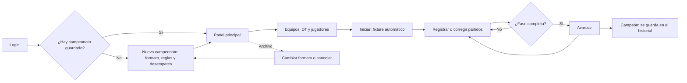

# Arquitectura de AlphaSport (V4)

AlphaSport está organizado en cuatro capas: **ui → service → persistence → model**. Cada capa solo conoce a la que está debajo, así que las reglas del torneo no dependen de ninguna pantalla ni del medio de almacenamiento.

```
            ┌──────────────── ui ─────────────────┐
            │  Escritorio (JavaFX)   Web (navegador)│
            │      Aplicacion      ServidorWeb + API│
            │          └── ApiControlador ──┘        │
            │              Presentador               │
            └──────────────────┬─────────────────────┘
                               ▼
            ┌────────────── service ──────────────┐
            │ CampeonatoService (casos de uso)     │
            │ MotorCampeonato, TablaPosiciones,    │
            │ Sanciones, ResumenCampeonato, ...    │
            │ formatos: Liga, Copa, Mundial, ...   │
            └──────────────────┬───────────────────┘
                               ▼
            ┌──────────── persistence ────────────┐
            │ RepositorioCampeonato (interfaz)     │
            │ RepositorioHistorial  (interfaz)     │
            │ ArchivoRepositorio... (archivos .dat)│
            └──────────────────┬───────────────────┘
                               ▼
            ┌─────────────── model ───────────────┐
            │ Campeonato, Equipo, Persona, Jugador,│
            │ DirectorTecnico, Partido, Tarjeta,   │
            │ Fase, ConfiguracionTorneo, enums     │
            └──────────────────────────────────────┘
```

## Capas en Java (`src/alphasport/`)

| Capa | Paquete | Responsabilidad | No hace |
|---|---|---|---|
| **ui** | `ui`, `ui.escritorio` | Mostrar la información y recibir las acciones del usuario. Hay dos interfaces: la ventana de escritorio en JavaFX y la interfaz web que sirve `ServidorWeb`. Ambas usan el mismo `ApiControlador` (traduce cada acción en una llamada al servicio) y el mismo `Presentador` (prepara tablas, llaves, sanciones e historial para la pantalla). | No aplica reglas del torneo ni guarda archivos. |
| **service** | `service`, `service.formatos` | Casos de uso (`CampeonatoService`: crear, cambiar formato, cancelar, avanzar, editar partidos, equipos, historial, respaldos) y reglas del torneo (`MotorCampeonato`, `TablaPosiciones`, `GeneradorFixture`, `Sanciones`, `ResumenCampeonato`, `Palmares`). Cada formato es una subclase de `FormatoCampeonato`. | No sabe cómo se dibuja la pantalla ni dónde se guardan los datos. |
| **persistence** | `persistence` | Interfaces `RepositorioCampeonato` y `RepositorioHistorial` con su implementación en archivos binarios (`datos/campeonato.dat` y `datos/historial/`). `PersistenciaException` aísla los errores de almacenamiento. | No conoce las reglas del torneo. |
| **model** | `model` | Entidades del dominio y enumeraciones. | No calcula tablas ni decide quién avanza. |

Para usar una base de datos (Fase 3) basta con crear, por ejemplo, `BdRepositorioCampeonato implements RepositorioCampeonato` y entregarla al `CampeonatoService` en `Arranque`; el servicio y las interfaces no cambian.

## Capas en la versión web (`web/js/`)

| Capa | Archivo | Responsabilidad |
|---|---|---|
| **ui** | `ui/app.js`, `index.html`, `css/estilos.css` | Dibuja el estado y envía las acciones al servicio. |
| **service** | `service/servicioRemoto.js` | Si la página la sirve el programa Java, envía cada acción a su API (`/api/...`). |
| | `service/servicioLocal.js` + `service/motor.js` | Si la página se abre sola, aplica las mismas reglas en JavaScript. |
| **persistence** | `persistence/almacen.js` | Guarda el campeonato y el historial en el navegador. |
| **model** | `model/modelo.js` | Constantes del dominio, creación del campeonato y datos de cada partido. |

Los dos servicios responden **exactamente el mismo JSON**, por eso la interfaz es una sola y no sabe con cuál está hablando.

## Las tres formas de ejecutar AlphaSport

| Forma | Clase / archivo | ui | service | persistence |
|---|---|---|---|---|
| Escritorio | `ui.escritorio.AlphaSportEscritorio` | JavaFX | Java | archivos `datos/` |
| Web con Java | `ui.AlphaSportApp` | navegador | Java (API local en `127.0.0.1`) | archivos `datos/` |
| Web sola | `web/index.html` | navegador | JavaScript | navegador |

## Diagrama de clases (resumen)


## Conceptos de POO aplicados

| Concepto | Dónde |
|---|---|
| **Herencia** | `Jugador` y `DirectorTecnico` heredan de `Persona`; los 6 formatos heredan de `FormatoCampeonato`. |
| **Clases abstractas** | `Persona.getRol()`; `FormatoCampeonato.validar / crearPrimeraFase / crearSiguienteFase`. |
| **Interfaces** | `RepositorioCampeonato` y `RepositorioHistorial` (persistencia intercambiable); `Serializable` en todo el modelo. |
| **Polimorfismo** | El motor llama `formato.crearSiguienteFase(...)` sin saber qué formato es; el servicio usa los repositorios por su interfaz. |
| **Encapsulamiento** | Atributos privados con getters/setters; la interfaz solo usa el servicio. |
| **Composición / agregación** | `Campeonato` contiene equipos, partidos, fases y configuración; `Equipo` agrega jugadores y DT; `Partido` contiene sus tarjetas. |
| **Excepciones propias** | `ReglaNegocioException` (con código `PENALES`, `CONFIRMAR`, `LOGIN`...) y `PersistenciaException`. |

## Ideas clave del diseño

1. **Las estadísticas se calculan, no se acumulan.** La tabla, las llaves y las suspensiones se deducen de los partidos cada vez; corregir un resultado deja todo correcto.
2. **Fases y pasos.** El formato decide qué fases hay; el motor sabe cómo se juega cada tipo de fase.
3. **Edición segura.** Si un cambio afecta rondas ya generadas, el servicio responde `CONFIRMAR` y la interfaz pregunta antes de regenerarlas.
4. **Cancelar o cambiar el formato.** `cancelar()` descarta el campeonato sin pasarlo al historial; `cambiarFormato()` lo rehace con otro formato conservando equipos y plantillas.
5. **Historial completo.** Cada campeonato terminado se guarda entero, así se pueden recalcular podio, premios y palmarés.

## Flujo de uso


